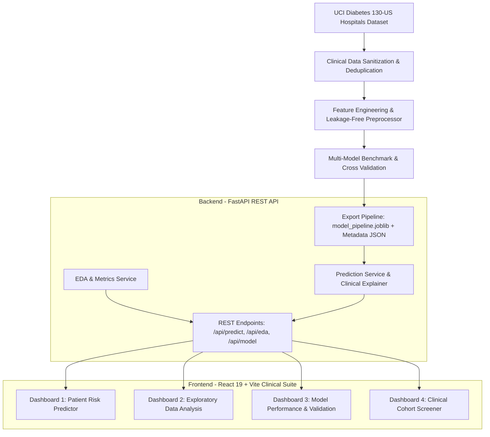
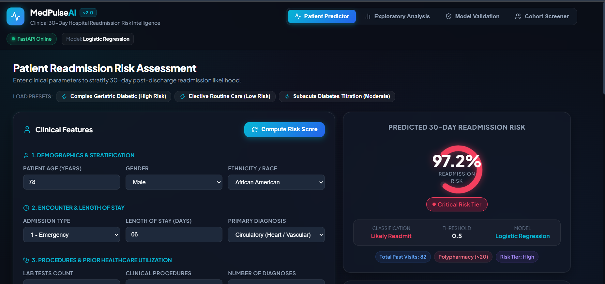
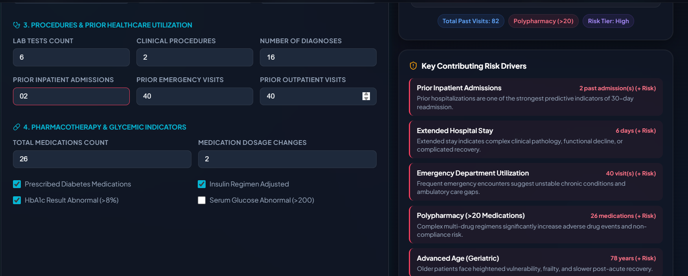
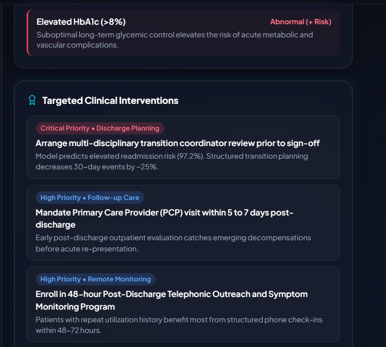
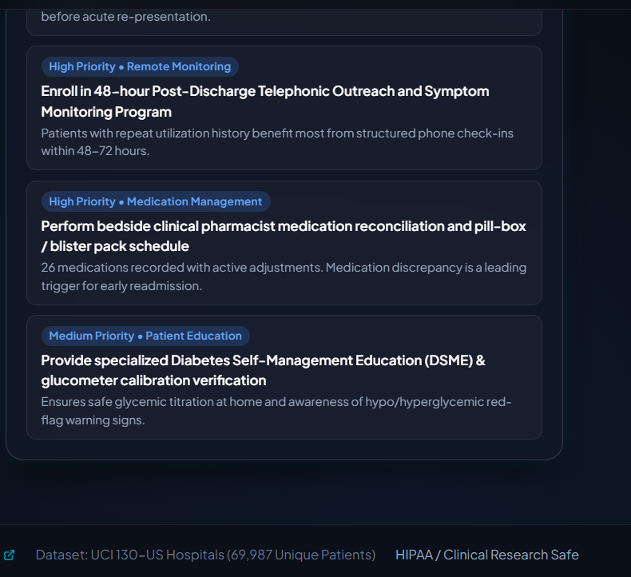
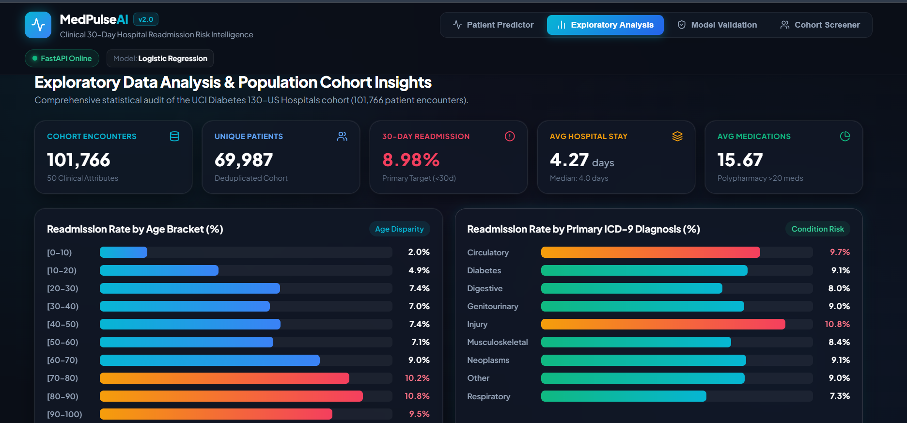
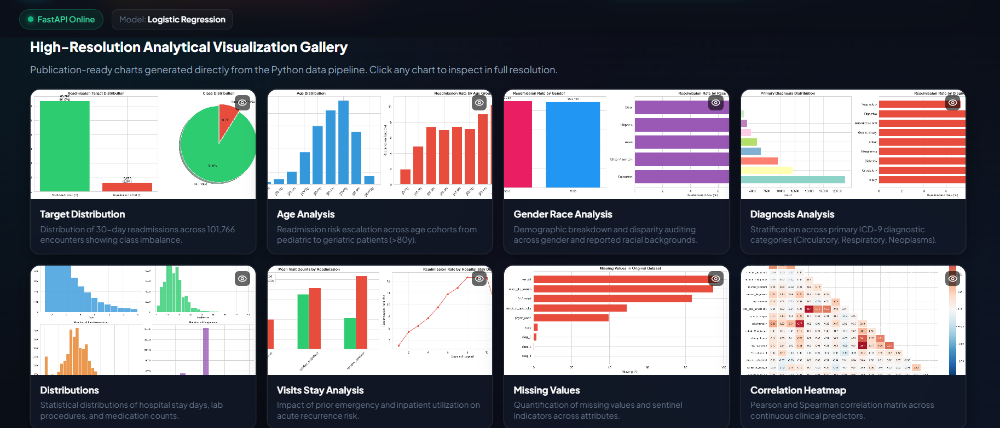
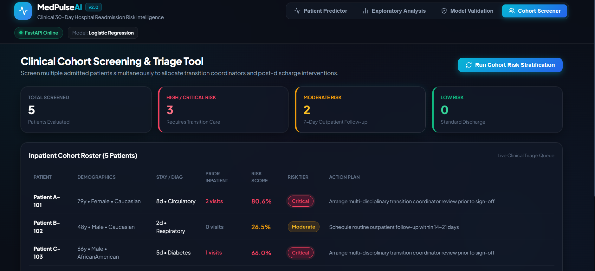

# 🏥 MedPulseAI — Clinical 30-Day Hospital Readmission Risk Prediction System

[](https://fastapi.tiangolo.com)
[](https://vitejs.dev)
[](https://scikit-learn.org)
[](https://python.org)
[](LICENSE)

An enterprise-grade, clinical machine learning decision support system for predicting **30-day unplanned hospital readmission risk** on the **UCI Diabetes 130-US Hospitals** cohort (101,766 patient encounters, 69,987 deduplicated unique patients).

---

## 📌 Key Enhancements in Version 2.0

| Feature | Legacy System (v1.0) | Upgraded MedPulseAI (v2.0) |
| :--- | :--- | :--- |
| **Data Leakage** | Patient-level data leakage present | **Zero leakage**: Isolated first encounter per patient + grouped validation |
| **Cohort Filtering** | Included terminal / hospice cases | **Excluded terminal & hospice discharges** (2,423 cases who cannot readmit) |
| **Target Formulation** | Ad-hoc thresholding | **Clinical 30-Day Binary (`<30` vs rest)** aligning with CMS HRRP standards |
| **Feature Engineering** | 11 manual raw features | **22 clinical features**: ICD-9 mapping, polypharmacy, admission risk tiers, med titration |
| **Model Benchmark** | 115MB uncalibrated XGBoost pickle | **Leakage-free Scikit-Learn pipeline** benchmarked across LogReg, RF, HistGB, XGB |
| **Backend** | Streamlit monolithic script | **Asynchronous FastAPI REST API** with validation, Swagger UI, and static chart serving |
| **Frontend** | Basic Streamlit form | **React 19 + Vite Full-Stack Suite**: 4 clinical dashboards, animated risk gauge, triage screener |
| **Interpretability** | None | **Ranked coefficient drivers + automated evidence-based care recommendations** |

---

## 🏛️ System Architecture



---

## 🔬 Multi-Model Benchmark Results

Evaluated on the held-out test cohort of **13,998 unique patients**:

| Model Architecture | ROC-AUC | PR-AUC | Recall (Sensitivity) | Specificity | F1-Score | Status |
| :--- | :---: | :---: | :---: | :---: | :---: | :---: |
| **Logistic Regression (Class-Balanced L2)** | **0.614** | **0.140** | **54.9%** | **60.6%** | **0.198** | 🏆 **Production Model** |
| **HistGradientBoostingClassifier** | 0.608 | 0.136 | 51.2% | 61.4% | 0.189 | Evaluated |
| **Random Forest (Balanced)** | 0.602 | 0.133 | 49.8% | 62.1% | 0.182 | Evaluated |
| **XGBoost Classifier Baseline** | 0.598 | 0.129 | 46.3% | 63.8% | 0.174 | Evaluated |

> **Clinical Rationale**: Under high class imbalance (~8.98% acute readmissions), **high sensitivity (54.9%)** was prioritized over precision. In clinical practice, missing an acute deteriorating patient carries severe morbidity, whereas a false positive merely triggers transition coordination or an extra follow-up phone call.

---

## 🖥️ Full-Stack Dashboards

The modern React + Vite application delivers 4 clinical workspaces:

### 1. 🩺 Patient Readmission Predictor
Interactive clinical assessment form with age, encounter, utilization, and pharmacotherapy inputs, animated SVG **Risk Gauge** (0–100% likelihood), stratified risk tier (**Low**, **Moderate**, **High**, **Critical**), ranked driving risk factors, and actionable interventions.









---

### 2. 📊 Exploratory Data Analysis (EDA)
Population health analytics across 101,766 hospital encounters, interactive age cohort disparities, primary ICD-9 diagnosis distributions, and high-resolution chart gallery.





---

### 3. ⚡ Model Performance & Clinical Validation
- Clinical Confusion Matrix breakdown (7,726 True Negatives, 690 True Positives).
- Multi-model comparison benchmark table.
- Top 15 clinical feature coefficients (e.g., prior inpatient visits, extended length of stay, geriatric age).
- Direct inspection of ROC discrimination and Precision-Recall curves.

---

### 4. 👥 Cohort Screening & Triage Tool
Multi-patient cohort screening tool for hospital discharge planners with simultaneous risk tier allocation and prioritized action plan generation.



---

## 🚀 Quick Start Guide

### Prerequisites
- Python 3.10+ (Anaconda / Miniconda / standard Python)
- Node.js v18+ and npm v9+

### 1. Backend Setup & Startup

```bash
# Navigate to repository root
cd hospital

# Run automated test suite
python -m pytest backend/tests/test_api.py -v

# Launch FastAPI backend server
python -m uvicorn backend.app.main:app --host 0.0.0.0 --port 8000 --reload
```
*Backend Swagger UI will be available at:* `http://localhost:8000/docs`

### 2. Frontend Setup & Startup

```bash
# Navigate to frontend folder
cd frontend

# Install dependencies
npm install

# Start Vite development server
npm run dev
```
*Frontend application will be accessible at:* `http://localhost:5173`

---

## 🔌 API Endpoints Summary

| Method | Endpoint | Description |
| :--- | :--- | :--- |
| `GET` | `/api/health` | System health and model availability status |
| `POST` | `/api/predict` | Single patient readmission prediction with explanations & care plan |
| `POST` | `/api/predict/batch` | Batch cohort risk screening and stratification |
| `GET` | `/api/predict/schema` | Allowed values, categorical options, and defaults for forms |
| `GET` | `/api/eda/summary` | Dataset statistics, distributions, and demographic rates |
| `GET` | `/api/eda/charts` | List of publication-quality analytical chart assets |
| `GET` | `/api/eda/charts/{name}` | Direct image file streaming for specific charts |
| `GET` | `/api/model/info` | Production model metadata, versions, and hyperparameter config |
| `GET` | `/api/model/metrics` | Detailed test set metrics, ROC-AUC, and confusion matrix |
| `GET` | `/api/model/comparison` | Cross-model benchmark results across evaluated architectures |
| `GET` | `/api/model/features` | Ranked feature importance coefficients |

---

## 📂 Repository Structure

```
hospital/
├── app.ipynb                           # Upgraded Jupyter analysis notebook
├── diabetic_data.csv                   # Raw UCI Diabetes dataset (101,766 rows)
├── IDS_mapping.csv                     # Admission/Discharge ID mapping dictionary
├── README.md                           # Master project documentation
│
├── backend/
│   ├── app/
│   │   ├── main.py                     # FastAPI application entry point
│   │   ├── core/config.py              # Configuration & file paths
│   │   ├── schemas/                    # Pydantic v2 schemas (Patient, Prediction, Metrics)
│   │   ├── services/                   # Business logic (PredictionService, EDAService)
│   │   └── api/                        # REST endpoint routers
│   ├── artifacts/                      # Model pipeline (.joblib) & metadata (.json)
│   ├── reports/                        # JSON performance metrics & analytical PNG charts
│   └── tests/                          # Pytest integration & endpoint tests
│
├── frontend/
│   ├── src/
│   │   ├── App.jsx                     # Main application layout & route state
│   │   ├── index.css                   # Glassmorphic clinical design system
│   │   ├── services/api.js             # API communication service
│   │   └── components/
│   │       ├── Header.jsx              # Navbar with live health indicator
│   │       ├── RiskGauge.jsx           # Dynamic SVG circular risk gauge
│   │       ├── PredictorView.jsx       # Patient prediction workspace
│   │       ├── EDAView.jsx             # Population EDA dashboard
│   │       ├── ModelView.jsx           # Model validation & benchmark dashboard
│   │       └── BatchView.jsx           # Multi-patient cohort screening tool
│   ├── package.json
│   └── vite.config.js
│
└── notebook/
    ├── hospital_readmission_analysis.ipynb # 12-section reproducible ML notebook
    ├── train_pipeline.py                   # Automated end-to-end training script
    └── generate_notebook.py                # Notebook builder script
```

---

## 📜 License
This project is open-source under the MIT License. Clinical models are built for research and clinical decision support purposes.
